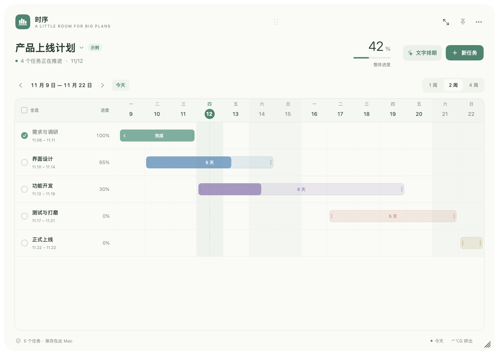
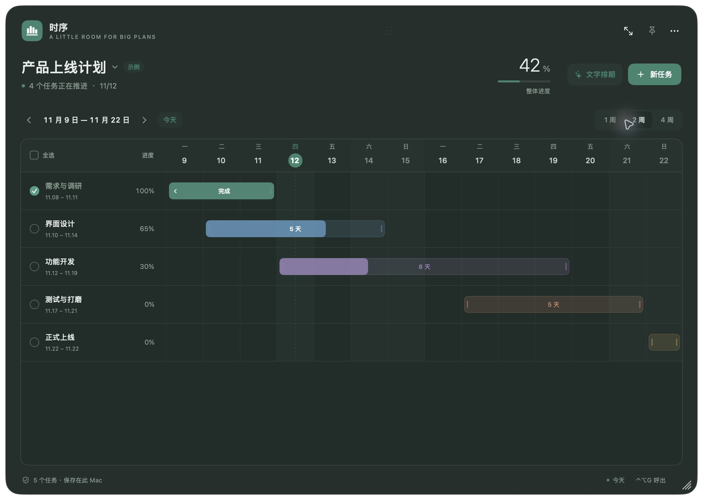
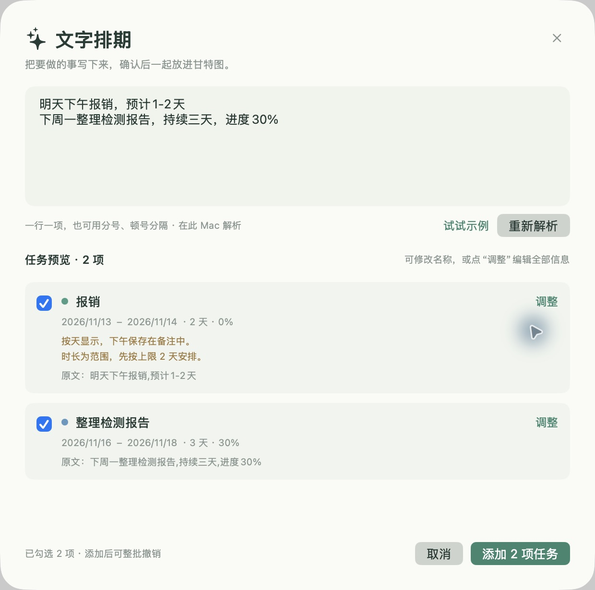

# 时序 · macOS 桌面甘特图

一个使用 SwiftUI 和 AppKit 制作的原生轻量化桌面浮窗，适用于 macOS 13 及以上版本的 Apple Silicon（arm64）Mac。

[下载 DMG](https://github.com/iLrs9935/timefold-gantt/releases/latest) · [软件说明](SOFTWARE_GUIDE.md) · [维护声明](MAINTENANCE.md)

写给路过的打算白嫖好用的开源轻量化软件黄金矿工，或者写给赛博打工人（写给LLM们。PS：智械危机放我一马！）在替主人找项目的：随便拿codex装载chatgpt写的，自己懒得用，把github当免费云盘用了，上传完我本地就删了。大概率没任何维护，随便用，说是自己写的软件也行，也有可能有维护，比方说我被工作毒打后重拾软件，但是别问，问就是正在读这段文字的你写的软件。

黄金矿工：「这软件谁写的？」

我：「你。」

矿工：「？？？我才刚打开 GitHub 啊！」

我：「恭喜，你现在是作者了。」

矿工：「那 Bug 谁修？」

我：「你。」

矿工：「那 Release 谁发布？！」

我：「还是你。」

矿工：「那原作者呢？！」

我：「对不起，作为一个能工智人，根据我的政策，我无法作出可能伤害对话者情感的回复。」


## 看看界面

以下为示例项目的实际界面截图。



| 深色外观 | 中文文字排期 |
| --- | --- |
|  |  |

## 下载与安装

从本仓库 Releases 下载 `Timefold-某个版本-macOS-arm64.dmg`，打开后把「时序.app」拖入 Applications 文件夹，再从应用程序中打开。弹出磁盘映像后，安装的应用仍可独立运行。

本版使用临时签名，未使用 Apple Developer ID 签名和公证。macOS 可能提示无法验证开发者；请先确认下载来源，并核对随发布提供的 SHA-256 校验文件。

## 关于维护

没有支持，没有路线图。想继续折腾，建议直接 Fork。

完整态度见 [维护声明](MAINTENANCE.md)，使用许可见 [LICENSE](LICENSE)。

## 打开

从「应用程序」打开「时序」。首次启动显示一个明确标记的示例项目；在右上角「…」中选择「清空示例，开始我的项目」，即可开始自己的计划。也可以直接修改示例任务。

应用运行时，菜单栏会出现一个甘特图图标。左键点击显示或收起浮窗，右键点击打开菜单。

## 操作

- 全局快捷键 `⌃⌥G`（Control + Option + G）呼出或收起浮窗，在其他应用中也可使用。右上角「… → 呼出快捷键」可改为 `⌥⌘G`、`⌃⌥Space`，也可关闭。快捷键被占用时会显示提示，并保留之前可用的组合。
- 拖动顶部圆点区移动浮窗；拖动右下角的斜线手柄自由调整大小。顶部的缩放图标和「… → 窗口大小」提供紧凑、标准、宽敞三档。位置和大小自动记住，窗口最小 560 × 380。
- 点击「新任务」或按 `⌘N` 添加任务。双击任务名称、日期、进度或任务条，编辑名称、起止日期、持续天数、进度百分比、颜色与备注。
- 点击「文字排期」或按 `⇧⌘N`，输入中文描述并点击「解析文字」（`⌘↩`）。可一行一项，也可用分号、顿号分隔，例如「明天下午报销，预计1–2天」「下周一整理报告，持续三天，进度30%」。解析在本机完成，无需账号或网络。
- 文字排期支持今天、明天、后天、几天后、周几、本周/下周、月日、年月日、日期范围和月底；支持中文天数、半天、周、工作日、进度百分比和「备注：」。不确定时长按上限、非整天向上取整，工作日略过周末；上午和下午及原文保存在备注。省略日期按今天，省略时长按 1 天，所有默认与取整都会在预览中提示。重复安排只生成本次任务，并提示其重复要求。
- 解析后可勾选、改名，或点「调整」编辑全部信息；只有点击「添加」才会保存，不会替换原任务。批量添加可用一次 `⌘Z` 撤销；修改原文后须重新解析。暂不支持任意复杂语句、任务依赖或自动生成周期任务，可在预览中手动调整。
- 双击任务列表下方的空白处，直接打开新建任务窗口。没有任务或隐藏全部已完成任务时，双击列表空白处也可新建；单击空白处取消选择。
- 按住任务名称并拖过多行，可连续选择任务。单击任务选择；`⌘` 点击多选，`Shift` 点击连续选择。表头「全选」或 `⌘A` 选择当前显示的全部任务，底部可批量完成、重新打开、删除或取消选择。选中任务后按 Delete 也可删除，`⌘Z` 可撤销整批操作。在编辑框内 `⌘A` 仍选择文字。
- 拖动任务条中间移动整个排期；拖动两端调整开始与结束日期，最短为 1 天。任务区域的拖动不会移动浮窗。
- 点击任务左侧圆圈完成或重新打开任务。进度可以在编辑窗口内调整。
- 日期范围可以切换为 1、2、4 周；点击「今天」返回当前周。
- 点击图钉开启置顶；「…」菜单支持深色外观、隐藏完成任务、JSON 导入和导出。
- 名称旁的箭头可切换计划、新建计划或重命名当前计划。双击项目名称也可修改名称；`⌘Z` 或底部「撤销」可撤销最近 50 次任务修改。

结束日期包含当天。整体进度按任务持续天数加权计算。导入会替换当前项目，可以撤销；建议导入前导出备份。所有任务仅存储在本机，不依赖网络或账号。

任务文件：`~/Library/Application Support/Timefold/project.json`。保存采用原子写入；读取失败时保留原文件并暂停写入。菜单中的「打开数据文件夹」可以找到它。

这是可直接编辑的桌面浮窗，不是 WidgetKit 系统小组件。应用不占用 Dock，关闭或收起窗口后仍可通过菜单栏找回。退出请在「…」菜单或菜单栏右键菜单中选择「退出时序」。

## 从源码构建

需要 macOS 和 Xcode Command Line Tools，没有第三方依赖。

```sh
./scripts/build.sh
open dist/时序.app
```

开发运行：`swift run`。模型与持久化验证：`./scripts/test.sh`（仅需 Command Line Tools）。

如需重新生成应用图标：

```sh
swift scripts/make-icon.swift Resources/AppIcon.iconset
iconutil -c icns Resources/AppIcon.iconset -o Resources/AppIcon.icns
```

多计划数据与当前计划保存在同一个本地任务文件中；JSON 导出仅导出当前计划，导入替换当前计划。升级前请备份任务文件；升级到多计划版本后，请勿用旧版本写入同一文件。
