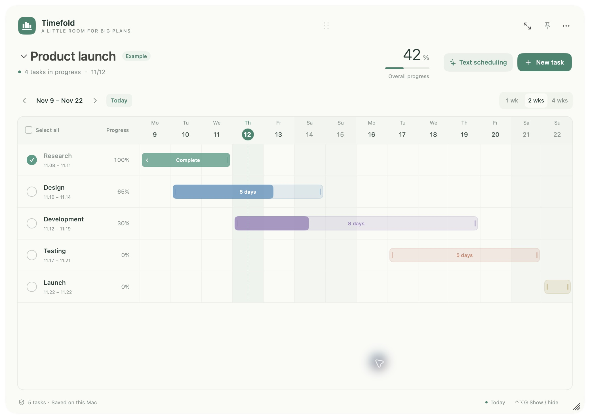
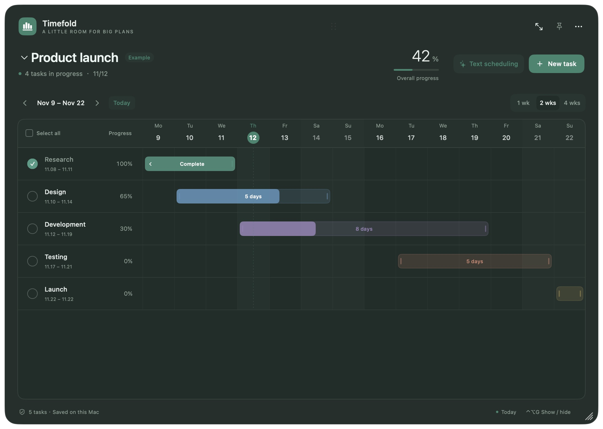
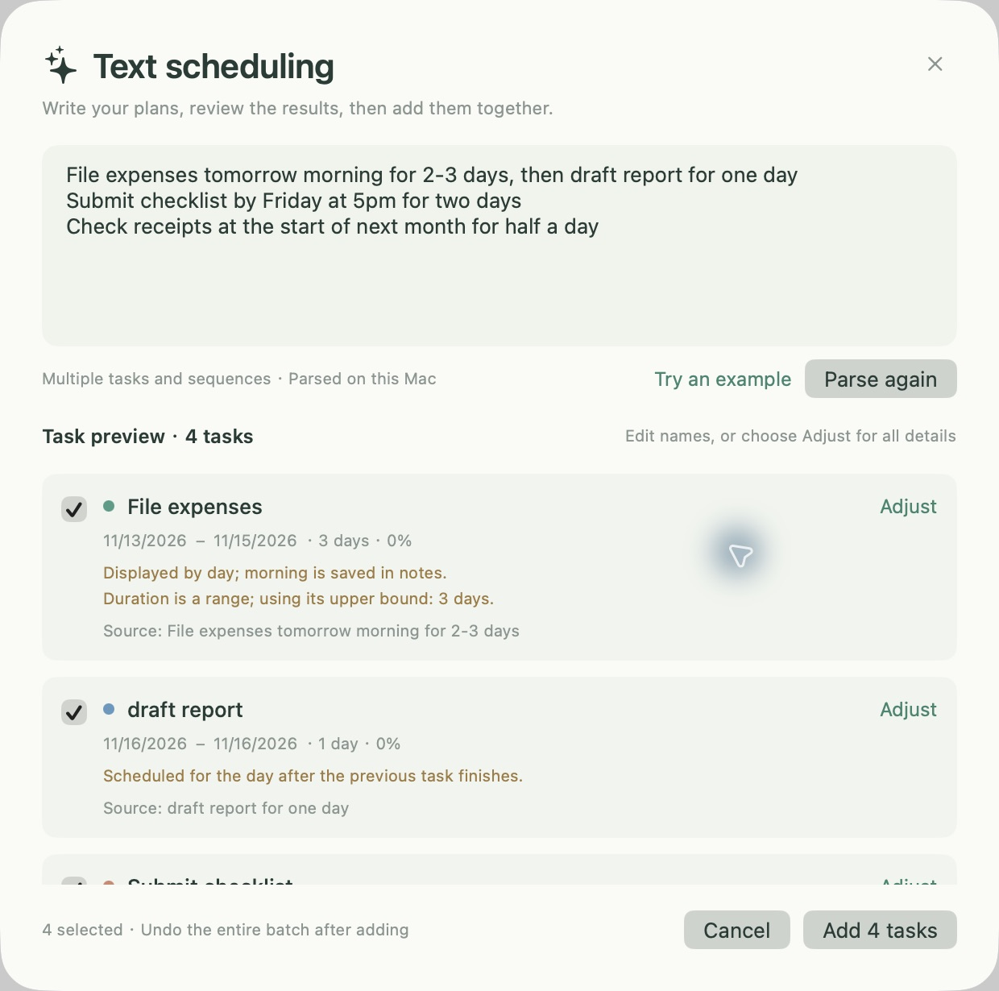

# Timefold · Desktop Gantt for macOS

English | [简体中文](README.zh-CN.md)

A lightweight native SwiftUI + AppKit Gantt widget for your desktop. **macOS 13+ · Apple Silicon (arm64)**.

[Download DMG](https://github.com/iLrs9935/timefold-gantt/releases/latest) · [User guide](SOFTWARE_GUIDE.en.md) · [Maintenance](MAINTENANCE.en.md) · [License](LICENSE)

For the open-source gold miners looking for handy little apps, and the cyber workers finding projects for their humans (yes, LLMs—spare me when the machines take over): I threw this together with Codex running ChatGPT, then couldn't be bothered to use it. GitHub is my free cloud drive; upload it and delete the local copy. Probably no maintenance. Use it however you like, even call it your own. Maybe work will beat me up enough to pick it up again. Don't ask, though: whoever is reading this wrote the app.

> “Who wrote this?” — “You.”
>
> “I just opened GitHub!” — “Congratulations. You're the author now.”
>
> “Who fixes the bugs? Who publishes releases?” — “Still you.”

## Screenshots

Actual screenshots using the built-in example project.



| Dark appearance | Text scheduling |
| --- | --- |
|  |  |

## Install

Download `Timefold-1.0.1-macOS-arm64.dmg` from Releases, open it, and drag the app into Applications. The app currently uses an ad-hoc signature and is **not Apple Developer ID signed or notarized**. Verify the download source and supplied SHA-256 checksum.

The first launch includes an example plan. Clear it in Settings to start your own, or edit it directly. The app lives in the menu bar and does not show a Dock icon.

## Features

- Create, switch, rename, delete and restore plans. Each plan keeps its own tasks.
- Drag the top grip to move the widget and the bottom-right grip to resize it. Pin it above other windows.
- Click a task circle to complete or reopen it. Double-click a task to edit its name, dates, duration, progress, color and notes.
- Drag task bars to move dates; resize either end to change duration. End dates are inclusive.
- Drag across task names to select a range, ⌘-click to toggle selection, or Shift-click for a range. Bulk complete/delete and undo are supported.
- Double-click the empty area below tasks to create a task.
- English and Chinese interfaces: Settings → Language / 语言. Existing task and plan names are kept as entered.
- Local JSON storage and import/export for the current plan. No account or network required for the app.

## English text scheduling

Open **Text scheduling** with **⇧⌘N**. Enter one or more descriptions and press **⌘Return** to parse:

```text
File expenses tomorrow afternoon for 2-3 days, then draft report for one day
Submit checklist by Friday at 5pm for two days
Test next Monday for three business days, progress 50%
Check receipts at the start of next month for half a day
```

Review and adjust the preview before adding. Parsing does not change your plans until you confirm.

- Dates: today, tomorrow, tonight, in three days, weekdays, named months and ISO dates.
- A bare weekday means its next occurrence, including today. “This Monday” means Monday of this calendar week; “next Monday” means Monday of the following calendar week. The preview states this choice.
- Deadlines such as “by Friday” are inclusive. With a duration, the start is inferred backward; business-day estimates skip weekends.
- “Then” starts the next task the day after the preceding task ends. This is a one-time calculation, not a live dependency.
- Duration ranges use the upper bound; fractional days and hour/minute estimates round up to whole days. Specific times are saved in notes; bars remain day-based.
- Missing start dates default to today and missing durations to one day. Defaults and inferences are shown for review.
- Keep free-form details after `Notes:`. Chinese descriptions remain supported. This is an offline parser for common scheduling phrases; unusual wording may need manual adjustment.

## Shortcuts and data

| Shortcut | Action |
| --- | --- |
| ⌃⌥G | Show / hide globally (configurable) |
| ⌘N | New task |
| ⇧⌘N | Text scheduling |
| ⌘A | Select all visible tasks; select text inside an editor |
| ⌘Z | Undo |

Data: `~/Library/Application Support/Timefold/project.json`. Back up this file before upgrades or imports. Import replaces the current plan; export includes only that plan. Deleted plans can be restored from the plan menu, including after restarting. Avoid writing multi-plan data with older app versions.

## Build

macOS and Xcode Command Line Tools; no third-party runtime dependencies.

```sh
./scripts/test.sh
./scripts/build.sh
./scripts/package-dmg.sh
```

See [维护声明 / Maintenance](MAINTENANCE.en.md). Support: none. Roadmap: none. Fork it and make it yours.
