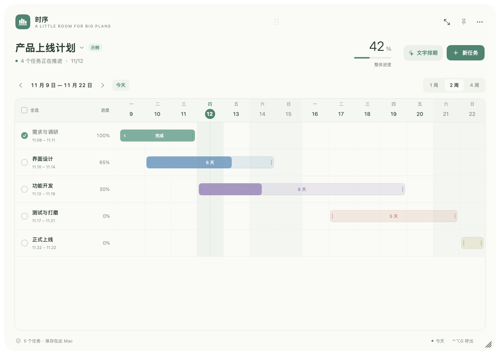

# 时序 1.3.0

原生 macOS 桌面甘特图浮窗，适用于 macOS 13+、Apple Silicon（arm64）。

- 可拖动、调节窗口大小、置顶和通过全局快捷键呼出。
- 可编辑任务起止日期、持续天数、进度、颜色和备注。
- 支持全选、多选、批量完成、批量删除和撤销。
- 双击任务编辑，双击列表下方空白处新建。
- 文字排期支持常见中文日期、时长、进度和多项任务；先预览修改，再确认添加。
- 任务只保存在本机，可通过 JSON 导入、导出。

## 安装

下载 DMG，将「时序.app」拖入 Applications。当前为临时签名，未经过 Apple Developer ID 签名和公证。随发布提供 SHA-256 校验文件。

## 使用与维护

详见软件说明和维护声明。许可随便，支持没有，路线图无。建议直接 Fork。

## 随便说两句

随便写的，自己懒得用，把github当免费云盘用了，上传完我本地就删了。大概率没任何维护，随便用，说是自己写的软件也行

## 软件截图

[深色外观](https://github.com/iLrs9935/timefold-gantt/blob/main/docs/images/gantt-dark.png) · [文字排期预览](https://github.com/iLrs9935/timefold-gantt/blob/main/docs/images/text-scheduling.png)
